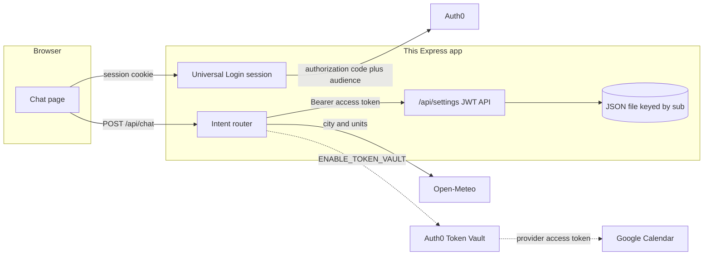
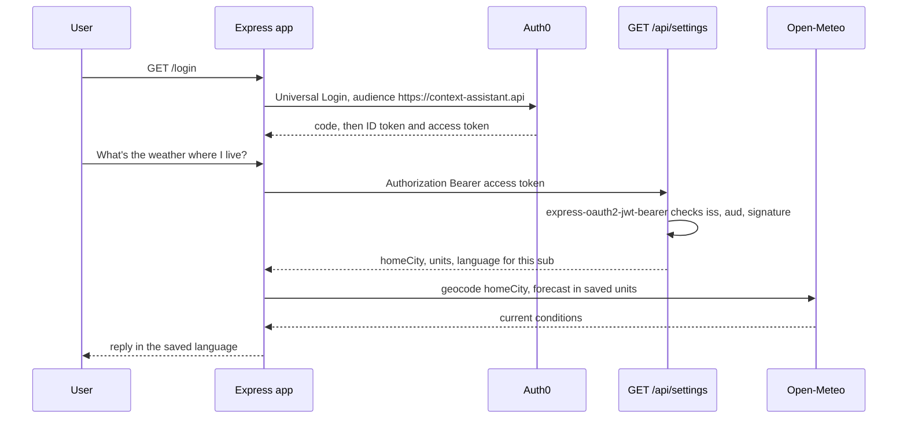

# Context Assistant

A small full-stack personal assistant for the MLH Global Hack Week challenge **The Context-Preserving Assistant**. You sign in with Auth0 Universal Login. A chat turn such as “What’s the weather where I live?” reads *your* saved home city, units, and language from a first-party API, then calls Open-Meteo with those settings.

The chat router is deterministic, so the app runs with no model key. If `OPENAI_API_KEY` is set, an OpenAI-compatible chat completion may rephrase the reply after the tools have already run. It does not choose the tools.

## Architecture





The browser never holds the access token. After login, `/api/chat` and `/api/me/settings` read the token from the Auth0 session and call `/api/settings` with `Authorization: Bearer`. That route is the first-party API. `express-oauth2-jwt-bearer` rejects a missing, expired, mistyped, or wrongly signed token before the handler reads the store.

Settings live in a JSON file (`SETTINGS_FILE`, default `./data/settings.json`). The key is the access token `sub`. A new user gets `{ homeCity: null, units: "celsius", language: "en" }` until they save something.

## Project layout

| Path | Role |
| --- | --- |
| `src/server.js` | Loads `.env` and listens |
| `src/app.js` | HTTP routes, session, and the chat loop |
| `src/middleware/check-jwt.js` | `express-oauth2-jwt-bearer` guard |
| `src/store/settings-store.js` | JSON settings keyed by `sub` |
| `src/agent/router.js` | Deterministic intent router |
| `src/services/weather.js` | Open-Meteo geocoding and forecast |
| `src/services/token-vault.js` | Optional Auth0 Token Vault exchange and Google Calendar |
| `public/` | The chat page |
| `test/` | Middleware, router, weather, and Token Vault tests |

## Auth0 dashboard

Tenant: `dev-wvxvhbnjrgvgn26x.us.auth0.com`.

Create two things: an API, then a Regular Web Application. Use the API identifier exactly. Auth0 puts it in the access token `aud` claim, and the API rejects anything else.

### 1. Create the API

1. Open [Auth0 Dashboard → Applications → APIs](https://manage.auth0.com/#/apis) (the same screen is sometimes labeled **Applications → APIs**).
2. Choose **Create API**.
3. Name: `Context Assistant API`.
4. Identifier: `https://context-assistant.api`. This string is the audience. It does not need to be a real URL, and you cannot change it later.
5. Signing algorithm: **RS256**.
6. Create the API.
7. Leave RBAC off unless you want it. This app does not require permissions in the token.
8. Optional, for silent refresh and the Token Vault refresh-token exchange: open the API settings and enable **Allow Offline Access**. Then set `AUTH0_SCOPE=openid profile email offline_access`. Skip this for the weather demo. Login is simpler without `offline_access` until that toggle is on.

You do not need to authorize the Regular Web App as a Machine-to-Machine client. The user signs in with Authorization Code and the app requests this audience.

### 2. Create the Regular Web Application

1. Open **Applications → Applications → Create Application**.
2. Name: `Context Assistant`.
3. Type: **Regular Web Application**. Confidential client, not a Single Page Application.
4. Under **Settings**, set:
   - Allowed Callback URLs: `http://localhost:3000/callback`
   - Allowed Logout URLs: `http://localhost:3000`
   - Allowed Web Origins: `http://localhost:3000`
5. If `APP_BASE_URL` is not `http://localhost:3000`, use that origin in all three fields and keep the path `/callback` on the callback URL.
6. Save.
7. Copy **Domain** (it should be `dev-wvxvhbnjrgvgn26x.us.auth0.com`), **Client ID**, and **Client Secret** into `.env`. Do not commit that file.
8. Under **Advanced Settings → Grant Types**, leave **Authorization Code** enabled. Add **Refresh Token** only if you enabled Allow Offline Access above.

The app requests `response_type=code` and `audience=https://context-assistant.api`, so the access token is a JWT for this API rather than an opaque token.

### 3. Confirm a token by hand

In the API’s **Test** tab, copy a token and call the settings route:

```bash
curl -s http://localhost:3000/api/settings \
  -H "Authorization: Bearer PASTE_TOKEN"
```

A valid token returns the default profile for that `sub`. A missing or junk token returns `401`.

## Token Vault and Google Calendar

Open-Meteo needs no key, so the normal weather turn does not use Token Vault. Token Vault is how this same assistant would call an API that *does* require a user token, such as Google Calendar, without putting the Google refresh token in this app.

Auth0 stores the provider token after the user connects Google. This server keeps only an Auth0 token, then exchanges it at `https://YOUR_DOMAIN/oauth/token`.

The grant type is:

`urn:auth0:params:oauth:grant-type:token-exchange:federated-connection-access-token`

The requested token type is:

`http://auth0.com/oauth/token-type/federated-connection-access-token`

Two exchanges are implemented. `TOKEN_VAULT_EXCHANGE=auto` uses a refresh token when the session has one, and otherwise uses the access token.

| Exchange | Subject token | Client that calls `/oauth/token` | When to use it |
| --- | --- | --- | --- |
| Refresh token | Auth0 refresh token (`urn:ietf:params:oauth:token-type:refresh_token`) | This Regular Web App | The confidential web app holds the user’s refresh token |
| Access token | Auth0 access token for `https://context-assistant.api` (`urn:ietf:params:oauth:token-type:access_token`) | A Custom API Client linked to that API | A caller only forwarded an Auth0 access token |

Official guides:

- [Configure Token Vault](https://auth0.com/docs/secure/call-apis-on-users-behalf/token-vault/configure-token-vault)
- [Refresh token exchange](https://auth0.com/docs/secure/call-apis-on-users-behalf/token-vault/refresh-token-exchange-with-token-vault)
- [Access token exchange](https://auth0.com/docs/secure/call-apis-on-users-behalf/token-vault/access-token-exchange-with-token-vault)

### Dashboard steps for the optional calendar path

1. In Google Cloud, create an OAuth client and enable the Google Calendar API. Note the client id and secret.
2. In Auth0, create or edit the **google-oauth2** social connection. Add the scope `https://www.googleapis.com/auth/calendar.events.readonly` along with the usual identity scopes. Turn on Token Vault / Connected Accounts for that connection so Auth0 keeps the Google refresh token. Enable the connection for this application.
3. Enable the Token Vault grant on the client that will perform the exchange:
   - Refresh-token exchange: **Applications → your Regular Web App → Advanced Settings → Grant Types → Token Vault**. Also enable **Refresh Token**. The app must request `offline_access`, and the API must allow offline access.
   - Access-token exchange: **Applications → APIs → Context Assistant API → Add Application**, which creates a Custom API Client. Token Vault should already be enabled on that client. Put its id and secret in `TOKEN_VAULT_CLIENT_ID` and `TOKEN_VAULT_CLIENT_SECRET`, and set `TOKEN_VAULT_EXCHANGE=access_token`.
4. If the tenant MFA policy is **Always**, Token Vault exchanges fail. Use **Never**, or an Action that skips MFA for this back-channel exchange. See the configure guide above.
5. Set `ENABLE_TOKEN_VAULT=true` and restart. Sign in with Google (or link the Google account) so a provider token exists in the vault.
6. Ask “What’s on my calendar?” The router calls Token Vault, then `GET https://www.googleapis.com/calendar/v3/calendars/primary/events`. The Google token stays on the server. The reply lists titles and start times only.

With the flag off, that question explains how to turn the path on and does not call Google. The code for the flag is `src/services/token-vault.js`, wired from `POST /api/chat` only when `ENABLE_TOKEN_VAULT=true`.

## Environment variables

Copy the example and edit it. `.env` is gitignored. The example keeps real-looking placeholders on purpose, except the tenant domain, which is the challenge tenant.

```bash
cp .env.example .env
```

| Variable | Purpose |
| --- | --- |
| `AUTH0_DOMAIN` | `dev-wvxvhbnjrgvgn26x.us.auth0.com` |
| `AUTH0_CLIENT_ID` | Regular Web App client id |
| `AUTH0_CLIENT_SECRET` | Regular Web App client secret |
| `AUTH0_SECRET` | Random string, at least 32 characters, used to encrypt the session cookie |
| `AUTH0_AUDIENCE` | `https://context-assistant.api` |
| `AUTH0_SCOPE` | Default `openid profile email`. Add `offline_access` only after the API allows it |
| `APP_BASE_URL` | `http://localhost:3000`. Must match the callback URL origin |
| `PORT` | `3000` |
| `SETTINGS_FILE` | JSON store path. Default `./data/settings.json` |
| `OPENAI_API_KEY` | Optional. Empty keeps the deterministic replies |
| `OPENAI_BASE_URL` | OpenAI-compatible base, default `https://api.openai.com/v1` |
| `OPENAI_MODEL` | Default `gpt-4o-mini` |
| `ENABLE_TOKEN_VAULT` | `false` by default. `true` enables the calendar path |
| `AUTH0_TOKEN_VAULT_CONNECTION` | Default `google-oauth2` |
| `TOKEN_VAULT_EXCHANGE` | `auto`, `refresh_token`, or `access_token` |
| `TOKEN_VAULT_CLIENT_ID` | Optional Custom API Client id. Falls back to `AUTH0_CLIENT_ID` |
| `TOKEN_VAULT_CLIENT_SECRET` | Optional Custom API Client secret. Falls back to `AUTH0_CLIENT_SECRET` |

Placeholder client id, secret, or session secret leave Universal Login off, so `npm start` still serves the page and the tests never need a tenant.

## Run

Requires Node.js 20 or newer.

```bash
npm install
cp .env.example .env
# fill in AUTH0_CLIENT_ID, AUTH0_CLIENT_SECRET, and a long AUTH0_SECRET
npm start
```

Open [http://localhost:3000](http://localhost:3000), choose **Log in**, and accept Universal Login. Then try the prompts under the transcript, or save a home city in the side panel. Saving and chatting both go through `GET` or `PUT /api/settings` with the access token.

Commands the router understands:

- What’s the weather where I live?
- What’s the weather in Lisbon?
- Set my home city to Portland
- Use fahrenheit
- Set my language to Spanish
- Show my settings
- What’s on my calendar?

Replies for weather, settings, and calendar follow the saved language (`en`, `es`, `fr`, `de`, `pt`). The command phrases above are matched in English.

## Tests

```bash
npm test
```

The auth tests build the same `express-oauth2-jwt-bearer` middleware with a local HS256 secret, so they do not call Auth0. They cover a missing token, a non-JWT, a bad signature, the wrong audience, the wrong issuer, an expired token, and an `alg=none` token. A valid token can read and write only that `sub`.

The router tests stub `getSettings`, `updateSettings`, `getWeather`, and the calendar function. “What’s the weather where I live?” must pass the saved city and units into the weather stub and must not call it when the city is unset. The calendar stub is not called while Token Vault is off.

`test/chat-flow.test.js` starts the app, writes settings with a signed access token, and checks that `POST /api/chat` calls the real `/api/settings` route before the weather stub.

## Example transcript

Ada’s saved profile ends as home city Portland, units Fahrenheit, language English. The Portland weather line is the exact reply for a clear 52°F, 8 mph reading. The Lisbon line is the same template for an explicit city, so the units still come from the saved profile. A live forecast uses whatever Open-Meteo returns.

```text
Ada: Set my home city to Portland
Assistant: Saved. Home city: Portland. Units: celsius. Language: English (en).

Ada: Use fahrenheit
Assistant: Saved. Home city: Portland. Units: fahrenheit. Language: English (en).

Ada: What's the weather where I live?
Assistant: It's 52°F and clear in Portland, United States, with wind at 8 mph. This uses your saved home city and unit preference.

Ada: What's the weather in Lisbon?
Assistant: It's 64°F and clear in Lisbon, Portugal, with wind at 11 mph. Temperature units come from your saved preferences.

Ada: Show my settings
Assistant: Home city: Portland
Units: fahrenheit
Language: English (en)

Ada: What's on my calendar?
Assistant: Calendar stays off until Auth0 Token Vault is enabled. Set ENABLE_TOKEN_VAULT=true after Google is connected and the federated token exchange is allowed. I will not call Google until then. The README has the dashboard steps.
```

After `Set my language to Spanish`, the same Portland forecast is phrased as:

```text
Hace 52°F y está despejado en Portland, United States, con viento de 8 mph. Usé tu ciudad de origen y tus unidades guardadas.
```

## API

| Method | Path | Auth | Body / response |
| --- | --- | --- | --- |
| `GET` | `/api/health` | none | Process flags |
| `GET` | `/api/session` | session cookie | `{ authenticated, user, domain, audience }` |
| `GET` | `/api/settings` | Bearer JWT | Profile for the token `sub` |
| `PUT` | `/api/settings` | Bearer JWT | `{ homeCity?, units?, language? }` |
| `GET` / `PUT` | `/api/me/settings` | session | Same profile, server attaches the access token |
| `POST` | `/api/chat` | session or Bearer JWT | `{ message }` → `{ reply, intent, settings, toolCalls }` |

`toolCalls` names what the turn did, for example `first-party getSettings` and `open-meteo forecast`. That list is also shown under each assistant message.

## Troubleshooting

- **Callback mismatch.** The callback URL in Auth0 must be exactly `${APP_BASE_URL}/callback`.
- **Login succeeds but chat says the access token is missing.** The authorize request has to include the audience. Confirm `AUTH0_AUDIENCE` is `https://context-assistant.api` and that API exists in this tenant.
- **401 audience or issuer mismatch on `/api/settings`.** The API identifier and the tenant domain must match the access token. Signing algorithm on the API stays RS256.
- **`offline_access` error at login.** Either enable Allow Offline Access on the API or remove `offline_access` from `AUTH0_SCOPE`.
- **Token Vault error.** The exchanging client needs the Token Vault grant, the user must have connected Google, and a tenant MFA policy of Always blocks the exchange.
